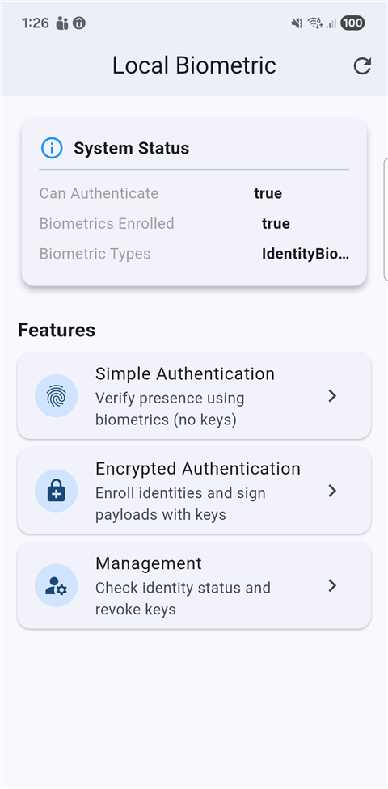
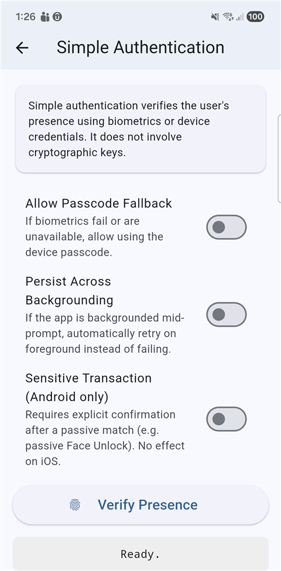
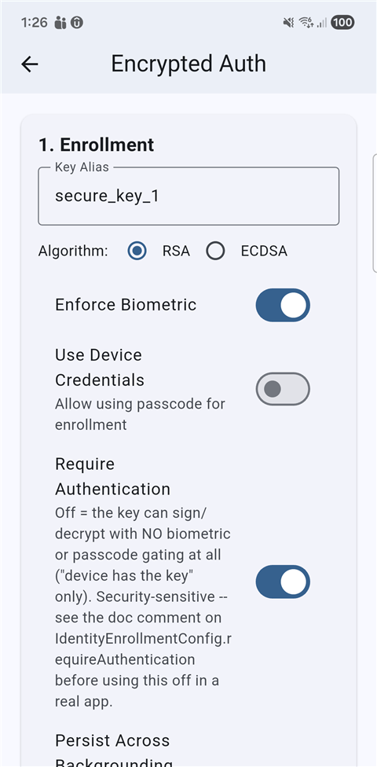
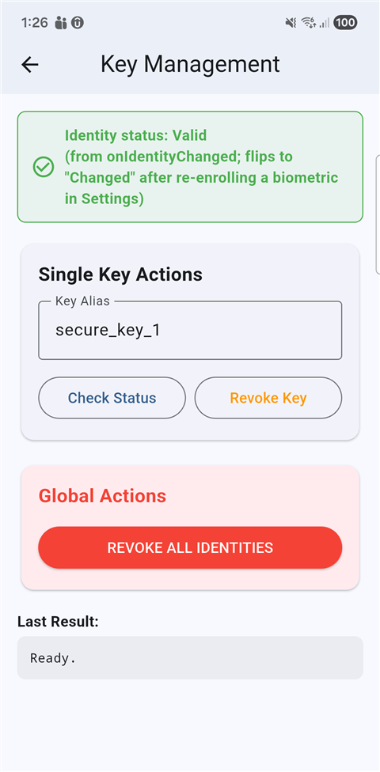

# local_biometric

[](https://pub.dev/packages/local_biometric)
[](https://pub.dev/packages/local_biometric/score)
[](LICENSE)
[](#platform-support)

Fingerprint, face and passcode authentication for Flutter, plus **hardware-backed keys** that sign
and decrypt only after the user proves it's them.

Check that the user is present in three lines. Or create an RSA or ECDSA key pair inside the
**Secure Enclave** (iOS/macOS) or **Android Keystore/StrongBox**. The private key never leaves
the secure hardware, not even to your Dart code.

<p align="center">
  
  
  
  
</p>

## Install

```yaml
dependencies:
  local_biometric: ^0.0.5
```

```dart
import 'package:local_biometric/local_biometric.dart';
```

**Android:** make your `MainActivity` extend `FlutterFragmentActivity`. Flutter's template uses
`FlutterActivity`, so this is one change:

```kotlin
import io.flutter.embedding.android.FlutterFragmentActivity

class MainActivity : FlutterFragmentActivity()
```

**Android permissions.** The plugin uses two permissions:

| Permission | Android version | Used for |
|---|---|---|
| `USE_BIOMETRIC` | 9+ (API 28+) | The system biometric prompt: fingerprint, face and iris. |
| `USE_FINGERPRINT` | 7–8.1 (API 24–27) | Fingerprint on older phones, which have no biometric prompt. |

Both are added to your app automatically, so you don't need to edit `AndroidManifest.xml`.
Android grants them at install time, so the user never sees a permission dialog. You can still
declare them yourself if you want them visible; that's harmless:

```xml
<uses-permission android:name="android.permission.USE_BIOMETRIC" />
<uses-permission android:name="android.permission.USE_FINGERPRINT" />
```

[more about permissions](doc/advanced.md#android-permissions)

**iOS:** add a Face ID reason to `ios/Runner/Info.plist`:

```xml
<key>NSFaceIDUsageDescription</key>
<string>Confirm it's you to sign in.</string>
```

Needs **Android 7.0+ (API 24)**, **iOS 16+** or **macOS 13+**. Windows support is partial; see
[Platform support](#platform-support).

**iOS and macOS need Swift Package Manager.** There's no CocoaPods podspec. Other plugins in your
app can still use CocoaPods. If SPM is off in your Flutter setup, turn it on with
`flutter config --enable-swift-package-manager`.

Set your app's iOS deployment target to 16.0 in Xcode
(Runner → General → Minimum Deployments). If a build fails with *"requires minimum platform
version 16.0 … but this target supports 15.0"* even though you already did, run the build again or
run `flutter clean`. Flutter's build tool can reset its generated plugin package to iOS 15.0 when
your dependencies have just changed, and the next build sets it back to 16.0.

## Quick start

**1. Check that the user is present.** No keys are involved:

```dart
final biometric = LocalBiometric();

final result = await biometric.verifyPresence(promptMessage: "Confirm it's you");
if (result.success == true) {
  // unlocked
}
```

**2. Create a hardware key** and send its public key to your server:

```dart
final key = await biometric.enrollIdentity(keyAlias: 'login_key');
await api.register(key.publicKey!);
```

**3. Sign with it.** The user sees a biometric prompt, and your server verifies the signature:

```dart
final sig = await biometric.signPayload(payload: challenge, keyAlias: 'login_key');
await api.verify(challenge, sig.signature!);
```

**4. Handle failures.** Calls don't throw for normal failures. Every result has a `code`:

```dart
if (sig.code != IdentityError.success) print(sig.code!.userMessage);
```

## Features

| Group | Features |
|---|---|
| [Presence](#presence) | [Check availability](#check-availability) · [Verify presence](#verify-presence) · [PIN fallback](#pin--passcode-fallback) |
| [Hardware keys](#hardware-keys) | [Enroll](#enroll-an-identity) · [Sign](#sign) · [Decrypt](#decrypt) · [Status & revoke](#status--revoke) · [Several keys](#several-keys) |
| [Staying in control](#staying-in-control) | [Biometric changes](#react-to-biometric-changes) · [Cancel a prompt](#cancel-a-prompt) · [Survive backgrounding](#survive-backgrounding) · [Lockouts](#lockouts) |
| [Errors](#errors) | One error enum on every platform, with `isRecoverable` and `userMessage` |

---

## Presence

### Check availability

Find out whether biometrics can be used, which kinds the device has, and why not if it can't.

```dart
final a = await biometric.checkAvailability();
print(a.canAuthenticate);      // true / false
print(a.availableBiometrics);  // [fingerprint, face, ...]
print(a.reason);               // e.g. NOT_ENROLLED, lockedOut

final hasLockScreen = await biometric.isDeviceSecure(); // keys need a PIN/passcode set
```

[example](example/lib/pages/home_page.dart)

### Verify presence

A biometric prompt with your own text. Good for "unlock this screen" or "confirm this payment".

```dart
final result = await biometric.verifyPresence(
  promptMessage: 'Confirm payment of \$25',
  config: PresencePromptConfig(
    subtitle: 'Payment',
    cancelButtonText: 'Not now',
    sensitiveTransaction: true, // Android: needs a tap even after a passive face match
  ),
);
print(result.authenticationType); // biometric or credential
```

[example](example/lib/pages/simple_auth_page.dart) ·
[all options](doc/advanced.md#presencepromptconfig-verifypresence)

### PIN / passcode fallback

Let the user enter their device PIN when biometrics fail or aren't set up.

```dart
await biometric.verifyPresence(
  promptMessage: 'Unlock',
  config: PresencePromptConfig(
    allowDeviceCredentials: true,
    biometricStrength: IdentityBiometricStrength.weak, // also allows PIN on Android 7–10
  ),
);
```

[Android version differences](doc/advanced.md#android-version-differences)

---

## Hardware keys

### Enroll an identity

Creates a key pair in secure hardware. Use RSA-2048 (the default) or ECDSA P-256.

```dart
final key = await biometric.enrollIdentity(
  keyAlias: 'login_key',
  keyFormat: IdentityKeyFormat.pem,
  config: IdentityEnrollmentConfig(
    signatureType: IdentitySignatureType.ecdsa,
    enforceBiometric: true, // prompt during enrollment too
    failIfExists: true,     // don't replace an existing key
  ),
);
print(key.publicKey); // -----BEGIN PUBLIC KEY----- ...
```

More options you can set in `IdentityEnrollmentConfig`:
- `enableDecryption`: the identity can also decrypt.
- `useDeviceCredentials`: the PIN can unlock the key as well.
- `setInvalidatedByBiometricEnrollment: false`: the key survives a new fingerprint.
- `requireAuthentication: false`: no prompt at all. Background use only.

[example](example/lib/pages/encrypted_auth_page.dart) ·
[all options](doc/advanced.md#identityenrollmentconfig-enrollidentity)

### Sign

Sign a string or raw bytes. Each signature needs a fresh biometric approval.

```dart
final sig = await biometric.signPayload(
  payload: 'nonce-8f3a2c',
  keyAlias: 'login_key',
  promptMessage: 'Sign in',
);
print(sig.signature);      // base64 (or hex)
print(sig.signatureBytes); // raw bytes

// bytes instead of a string:
await biometric.signPayloadBytes(payload: utf8.encode('{"amount":25}'), keyAlias: 'login_key');
```

Signatures are `SHA256withRSA` or `SHA256withECDSA` and verify with any standard library.
[server guide](doc/advanced.md#server-side-integration)

### Decrypt

Your server encrypts to the identity's public key. Only this device, after a biometric check, can
read it.

```dart
await biometric.enrollIdentity(
  keyAlias: 'vault_key',
  config: IdentityEnrollmentConfig(enableDecryption: true),
);

final d = await biometric.decryptPayload(payload: encryptedBase64, keyAlias: 'vault_key');
print(d.decryptedData);
```

[Which encryption to use on your server](doc/advanced.md#encryption-for-decryptpayload)

### Status & revoke

Look at a key without a prompt, or delete it.

```dart
final info = await biometric.getIdentityStatus(keyAlias: 'login_key');
print('${info.exists} ${info.algorithm} ${info.keySize}');

await biometric.revokeIdentity(keyAlias: 'login_key'); // one key
await biometric.revokeAllIdentities();                 // every key this plugin made
```

[example](example/lib/pages/management_page.dart)

### Several keys

Give each purpose its own `keyAlias`. If you leave it out, the plugin uses one default key.

```dart
await biometric.enrollIdentity(keyAlias: 'login_key');
await biometric.enrollIdentity(keyAlias: 'payment_key');
```

---

## Staying in control

### React to biometric changes

By default, a key stops working when the user adds or removes a fingerprint or face. Listen for
that change so you can ask the user to enroll again:

```dart
biometric.onIdentityChanged.listen((status) async {
  if (status == IdentityStatus.changed) {
    await biometric.revokeIdentity(keyAlias: 'login_key');
    // ask the user to enroll again, then:
    await biometric.acknowledgeIdentityChange();
  }
});
```

[example](example/lib/pages/management_page.dart)

### Cancel a prompt

Close the prompt that's showing, for example on a timeout or when the user leaves the screen.

```dart
await biometric.stopAuthentication();
```

### Survive backgrounding

If the app goes to the background while the prompt is open, the call runs again from the start
when the user comes back.

```dart
await biometric.signPayload(
  payload: challenge,
  keyAlias: 'login_key',
  config: IdentitySignatureConfig(persistAcrossBackgrounding: true),
);
```

[how it works](doc/advanced.md#how-persistacrossbackgrounding-works)

### Lockouts

After too many failed attempts, biometrics lock. Entering the device passcode unlocks them again.

```dart
if (result.code == IdentityError.lockedOut ||
    result.code == IdentityError.lockedOutPermanent) {
  await biometric.verifyPresence(
    promptMessage: 'Enter your passcode to re-enable biometrics',
    config: PresencePromptConfig(
      allowDeviceCredentials: true,
      biometricStrength: IdentityBiometricStrength.weak,
    ),
  );
}
```

---

## Errors

Every result carries an `IdentityError` code, and it's the same on every platform.

```dart
final code = result.code ?? IdentityError.unknown;
if (code.isRecoverable) {
  // show "Try again"
} else {
  showDialog(
    context: context,
    builder: (_) => AlertDialog(content: Text(code.userMessage)),
  );
}
```

[All 18 codes and what they mean](doc/advanced.md#error-codes)

## Platform support

| | Android | iOS | macOS | Windows |
|---|---|---|---|---|
| Presence check | ✅ | ✅ | ✅ | ⚠️ stub |
| Enroll & sign | ✅ | ✅ | ✅ | ✅ RSA only |
| Decrypt | ✅ | ✅ | ✅ | ⚠️ experimental |
| Biometric change events, cancel | ✅ | ✅ | ✅ | ❌ |
| Secure hardware | StrongBox / TEE | Secure Enclave | Secure Enclave | TPM |

Some features depend on the Android version; for example, PIN fallback for keys needs Android 11.
See [Android version differences](doc/advanced.md#android-version-differences) and the
[Windows notes](doc/advanced.md#windows).

## Good to know

- **Test on a real device.** Emulators can't fully use secure hardware. On an Android emulator,
  `adb -e emu finger touch 1` simulates a fingerprint.
- **A screen lock is required.** If the user removes it, the system permanently invalidates every key.
- **The private key never reaches Dart.** You only ever get the public key, signatures and
  decrypted data.
- **Lockouts can't be reset in code.** Only the user's passcode clears them.

More in [Limitations & known issues](doc/advanced.md#limitations--known-issues).

## What's new in 0.0.5

- **Android 7.0+:** the minimum Android version dropped from 9 to 7.
- **Ready for Flutter 3.50:** no more Kotlin-plugin build warning.
- **Smoother on Android:** key creation and crypto no longer run on the UI thread.
- **Fixes:** `biometricStrength` now works, and PIN fallback for presence checks now works on
  Android 7–10.
- **iOS/macOS: Swift Package Manager only.** The CocoaPods podspecs are gone; apps need SPM
  turned on. Other plugins in your app can still use CocoaPods.
- **Newer Android libraries:** `androidx.biometric` 1.4.0-rc01 (was an alpha), `appcompat`
  1.8.0, `lifecycle-common` 2.11.1.
- No changes to the Dart API, iOS, macOS or Windows code, or existing keys.

See [CHANGELOG.md](CHANGELOG.md) for everything.

## Example app

[`example/`](example) has one page each for presence checks, hardware keys and key management. To
run it: `cd example && flutter run`.

## Learn more

- [Advanced guide](doc/advanced.md): every option, result field and error code, plus server-side
  formats and platform details
- [CHANGELOG.md](CHANGELOG.md)

## Contributing

Issues and pull requests are welcome on
[GitHub](https://github.com/devamitkumartiwari/local_biometric/issues). For an architecture
overview, see
[CLAUDE.md](https://github.com/devamitkumartiwari/local_biometric/blob/main/CLAUDE.md).
For support or business inquiries, see the [web portal](https://hireamit.web.app/).

## License

MIT. See [LICENSE](LICENSE).
